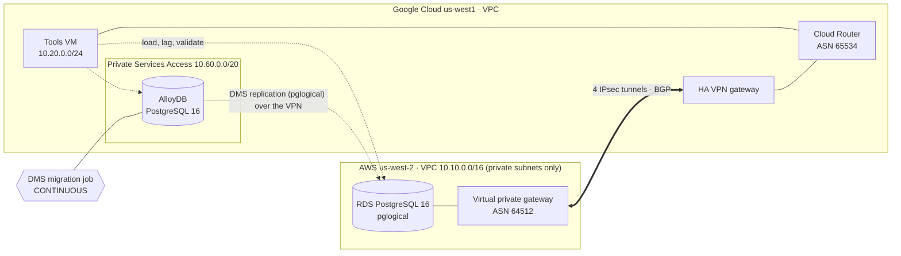
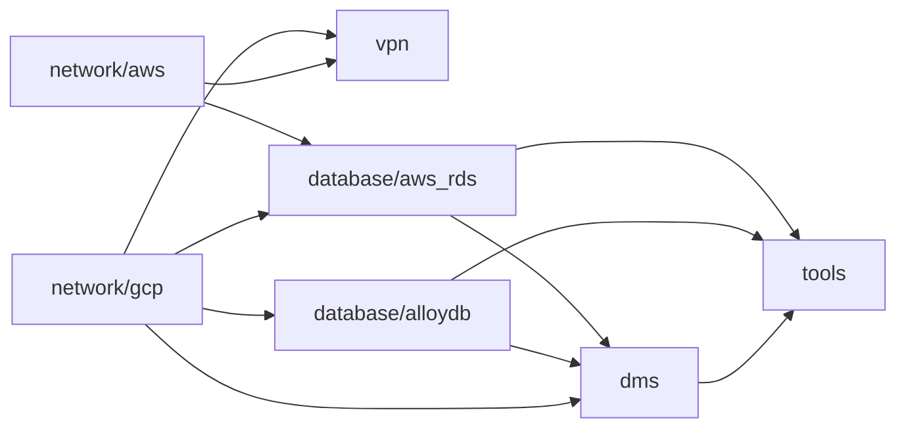

# rds-to-alloydb-dms

A continuous, low-downtime migration of **Amazon RDS for PostgreSQL** to
**Google Cloud AlloyDB** with **Database Migration Service (DMS)**, over a
private **HA VPN** between AWS and Google Cloud. Both databases, the VPN, and
the DMS migration job are provisioned with Terraform. Scripts load mock data,
generate live writes during replication, measure lag, validate row-for-row,
and handle cutover.

## Contents

- [Architecture](#architecture)
- [The networking gotchas](#the-networking-gotchas)
- [Repository layout](#repository-layout)
- [Prerequisites](#prerequisites)
- [Running the migration](#running-the-migration)
- [Troubleshooting](#troubleshooting)
- [Security posture](#security-posture)
- [Cost and teardown](#cost-and-teardown)
- [Limits](#limits)

## Architecture



- **Source:** RDS for PostgreSQL 16 in private subnets with no internet
  gateway. The only path in is the VPN. A custom parameter group enables
  logical replication and preloads `pglogical`.
- **Network:** GCP HA VPN (2 interfaces) to two AWS site-to-site VPN
  connections, for **4 IPsec tunnels with 4 BGP sessions**. Routes are
  exchanged dynamically, with no static routes on either side.
- **Destination:** an AlloyDB cluster created by Terraform. DMS demotes it to
  a replica, runs a full dump, then streams changes (CDC) until you promote it.
- **Tools VM:** a small GCE VM (IAP SSH only) that reaches RDS over the VPN
  and AlloyDB over PSA. All database work runs from here.

## The networking gotchas

DMS replication is driven from the **AlloyDB side**, so the connection to RDS
originates from the AlloyDB private services access range, not from your VPC's
subnets. Three things have to line up, and each one fails silently as a
connection timeout:

| # | Gotcha | Fix | Where |
|---|---|---|---|
| 1 | The PSA peering doesn't share BGP-learned routes by default, so AlloyDB has no route to AWS. | Peering route config with `import_custom_routes` and `export_custom_routes`. | `infra/network/gcp/psa.tf` |
| 2 | Cloud Router's `ALL_SUBNETS` doesn't include the PSA range, so AWS has no route back to AlloyDB. | Custom advertisement of the PSA range on the Cloud Router. | `infra/network/gcp/network.tf` |
| 3 | The RDS security group must allow the PSA range, not just the GCP subnet. | Ingress 5432 from both CIDRs. | `infra/database/aws_rds/rds.tf` |

On the database side:

- RDS needs `rds.logical_replication = 1` and `pglogical` in `shared_preload_libraries`.
- The `pglogical` extension must exist in **every** database, including `postgres`.
- The DMS user needs `rds_replication`.
- RDS for PostgreSQL 15+ forces SSL by default, so the connection profile uses SSL.

## Repository layout

```
infra/                    seven Terraform stacks, each with its own state
  common_variables.tf     shared variables (copied into every stack; CI checks they match)
  common.tfvars.example   project, state bucket, regions -> copy to common.tfvars
  network/gcp/            VPC, tools subnet, IAP firewall, Cloud Router (BGP + custom ads),
                          Cloud NAT, PSA range + peering route export, APIs
  network/aws/            VPC, private subnets, route table, VGW, route propagation
  vpn/                    vpn_aws.tf (customer gateways, 2 VPN connections, PSKs)
                          vpn_gcp.tf (HA VPN gateway, external gateway, 4 tunnels, BGP peers)
  database/aws_rds/       subnet group, security group, pglogical parameter group, RDS,
                          admin password in Secret Manager
  database/alloydb/       AlloyDB cluster + primary, postgres password in Secret Manager
  dms/                    DMS user password, connection profiles, migration job (NOT_STARTED)
  tools/                  tools VM, service account, access to the three secrets
db/                       runs on the tools VM
  bootstrap-source.sh     verify parameters, create DB, schema + mock data, DMS user + grants
  load.sh                 live INSERT/UPDATE/DELETE + heartbeat (start | stop | status)
  lag.sh                  end-to-end replication lag from the heartbeat
  validate.sh             per-table row counts + content checksums, source vs destination
  post-promote.sh         reset sequences on AlloyDB, write test
  sql/                    schema, deterministic seed data, DMS user, per-database grants
scripts/                  run on your laptop
  tf.sh                   terraform for one stack or all of them, in dependency order
  vm.sh                   copy db/ to the VM and run a script there over IAP
  check-vpn.sh            tunnels, BGP sessions, learned routes on both clouds
  dms.sh                  verify | demote | start | status | watch | promote
```

The mock data is an e-commerce schema: 50,000 customers, 5,000 products,
200,000 orders, and 600,000 order items, generated deterministically so the
checksums are reproducible. Every table has a primary key, because without
one DMS replicates only `INSERT`s during CDC.

## Prerequisites

- **Google Cloud:** a project with billing, `gcloud` authenticated, and
  permission to create networks, AlloyDB, DMS, Secret Manager, and Compute resources.
- **AWS:** an account and `aws` CLI credentials (`AWS_PROFILE` or the default
  chain) with permission to create VPC, VPN, and RDS resources.
- Terraform ≥ 1.6, `jq`, and a GCS bucket for state.

## Running the migration

Commands run from the repo root unless noted.

### 1. Provision both clouds

The infrastructure is split into seven Terraform stacks, each with its own
state, applied in dependency order. Every plan stays small enough to read
line by line. A change to one area, such as re-creating the DMS job, can't
touch anything else, and the databases sit in stacks you rarely re-apply.



Stacks pass values to each other through `terraform_remote_state`. For
example, `database/aws_rds` reads the AlloyDB PSA range from `network/gcp` to
build its security group, so nothing is copied by hand between stacks.

| # | Stack | Creates | Plan | Approx. time |
|---|---|---|---|---|
| 1 | `network/gcp` | APIs, VPC, tools subnet, IAP firewall, Cloud Router with the PSA advertisement, Cloud NAT, PSA range + route export | 14 to add | 2–3 min |
| 2 | `network/aws` | VPC, 2 private subnets, route table, VGW with route propagation | 8 to add | 1 min |
| 3 | `vpn` | 2 customer gateways, 2 AWS VPN connections, HA VPN gateway, external gateway, 4 tunnels, 4 router interfaces, 4 BGP peers, 4 pre-shared keys | 22 to add | 5 min |
| 4 | `database/aws_rds` | Parameter group, subnet group, security group, RDS instance, admin password secret | 7 to add | 10 min |
| 5 | `database/alloydb` | AlloyDB cluster + primary instance, postgres password secret | 5 to add | 15–20 min |
| 6 | `dms` | DMS user password secret, source + destination connection profiles, migration job | 6 to add | 1 min |
| 7 | `tools` | Service account, IAM + secret access, tools VM | 6 to add | 1 min |

**One-time setup.** Create a private, versioned state bucket, and fill in the
shared variables:

```bash
export PROJECT=$(gcloud config get-value project)
gcloud storage buckets create "gs://${PROJECT}-tfstate" --location us-west1 --uniform-bucket-level-access
gcloud storage buckets update "gs://${PROJECT}-tfstate" --versioning

cp infra/common.tfvars.example infra/common.tfvars    # set project_id and state_bucket
```

`common.tfvars` is gitignored. `scripts/tf.sh` passes it to every stack and
gives each stack its own state path: `gs://<bucket>/rds-to-alloydb-dms/<stack>`.

**Check every stack before applying anything.** This runs `terraform fmt
-check`, `terraform init`, and `terraform validate` in all seven stacks, in
dependency order, and stops at the first problem:

```bash
scripts/tf.sh all check
```

Each stack should end with:

```
=== network/gcp: terraform check
fmt: ok
init: ok (state: gs://<bucket>/rds-to-alloydb-dms/network/gcp)
Success! The configuration is valid.
```

If formatting differs, the script stops and prints the fix:
`scripts/tf.sh infra/<stack> fmt` rewrites the files, then run the check again.
`validate` needs no cloud access and no upstream state, so the whole check
works before anything exists.

**Record provider checksums for every platform.** The first `init` in each
stack creates a `.terraform.lock.hcl` that pins the exact google, aws, and
random provider versions. These files are committed, so CI and every later
run use the same providers you validated with. But `init` only records
checksums for the machine it ran on. Run this once after the first check, and
again after any provider upgrade (`terraform init -upgrade`):

```bash
scripts/tf.sh all lock
```

This adds checksums for `darwin_arm64` (Apple Silicon), `darwin_amd64`
(Intel Macs), and `linux_amd64` (the GitHub Actions runners) to all seven
lock files. Without it, CI on Linux has to fill in its own entries on every
run, and someone cloning the repo on a different platform gets lock-file
changes they didn't make. Commit the result:

```bash
git add infra/*/.terraform.lock.hcl infra/*/*/.terraform.lock.hcl
git commit -m "Lock provider checksums for macOS and Linux"
```

**Then plan, review, and apply one stack at a time.** Unlike `validate`,
`plan` can't run for all seven up front: each stack reads the outputs of the
stacks before it, and those don't exist until they're applied. So for each
stack, in order, save the plan, read it, then apply exactly that plan:

```bash
scripts/tf.sh infra/network/gcp plan -out=tfplan       # review: Plan: 14 to add
scripts/tf.sh infra/network/gcp apply tfplan

scripts/tf.sh infra/network/aws plan -out=tfplan       # review: Plan: 8 to add
scripts/tf.sh infra/network/aws apply tfplan

scripts/tf.sh infra/vpn plan -out=tfplan               # review: Plan: 22 to add
scripts/tf.sh infra/vpn apply tfplan

scripts/tf.sh infra/database/aws_rds plan -out=tfplan  # review: Plan: 7 to add
scripts/tf.sh infra/database/aws_rds apply tfplan

scripts/tf.sh infra/database/alloydb plan -out=tfplan  # review: Plan: 5 to add
scripts/tf.sh infra/database/alloydb apply tfplan

scripts/tf.sh infra/dms plan -out=tfplan               # review: Plan: 6 to add
scripts/tf.sh infra/dms apply tfplan

scripts/tf.sh infra/tools plan -out=tfplan             # review: Plan: 6 to add
scripts/tf.sh infra/tools apply tfplan
```

Applying a saved plan doesn't ask for confirmation, because you already
reviewed it, and it fails if anything changed since the plan was made.
`tf.sh` deletes the plan file after applying it: plan files contain every
generated password and VPN pre-shared key in plain text (they're also
gitignored). If a plan shows anything other than the expected number of
additions on a fresh build, stop and investigate before applying.

`scripts/tf.sh infra/<stack> apply` without a plan file also works; it plans and
asks for `yes` in one step.

The two network stacks don't depend on each other, and neither do the two
database stacks, so you can run each pair in separate terminals. Running
`database/aws_rds` and `database/alloydb` side by side saves about 10 minutes.

`scripts/tf.sh all apply` runs all seven in order, prompting for each plan,
if you'd rather not save plan files.

**Per-stack settings** go in a gitignored `terraform.tfvars` inside that
stack's folder, picked up automatically. For example, the cheaper non-HA
AlloyDB:

```bash
echo 'alloydb_availability_type = "ZONAL"' > infra/database/alloydb/terraform.tfvars
```

Terraform creates the DMS connection profiles and migration job but doesn't
start the job. That's step 4.

### 2. Check the VPN

```bash
scripts/check-vpn.sh
```

Expect all 4 GCP tunnels `ESTABLISHED`, 4 BGP peers `UP`, the AWS VPC CIDR
(`10.10.0.0/16`) learned by GCP, and the tools subnet plus the PSA range
(`10.60.0.0/20`) propagated into the AWS route table. If the PSA range is
missing on the AWS side, gotcha 2 is the cause.

### 3. Prepare the source and load mock data

```bash
scripts/vm.sh bootstrap-source.sh
```

The script checks the parameter group is active, creates the `shop` database,
loads the schema and data, creates `dms_user`, and installs `pglogical` with
grants in both `postgres` and `shop`. It ends with:

```
    table_name   | count
-----------------+--------
 customers       |  50000
 products        |   5000
 orders          | 200000
 order_items     | 600000
Source ready for DMS.
```

If it reports that `shared_preload_libraries` doesn't include `pglogical`,
reboot the instance once (the command is printed; the identifier comes from
`scripts/tf.sh infra/database/aws_rds output identifier`) and run it again.

### 4. Demote, verify, and start the migration

```bash
scripts/dms.sh demote     # AlloyDB becomes a replica of the source
scripts/dms.sh verify     # DMS checks source config + connectivity
scripts/dms.sh start      # full dump, then CDC
```

RDS sources pause writes briefly (under a minute) when the job starts.

### 5. Replicate under live writes

```bash
scripts/vm.sh load.sh start      # INSERT + UPDATE + DELETE + heartbeat every 0.5 s
scripts/dms.sh watch             # phase goes FULL_DUMP -> CDC
scripts/vm.sh lag.sh --watch     # once in CDC, lag should hover near 0
```

`lag.sh` compares the heartbeat on both sides:

```
15:33:13  source 2026-10-14 15:33:01.48+00  destination 2026-10-14 15:33:01.48+00  lag 0.0s
```

### 6. Cut over

```bash
scripts/vm.sh load.sh stop       # 1. stop writes to the source
scripts/vm.sh lag.sh             # 2. wait for lag 0.0s
scripts/vm.sh validate.sh        # 3. prove source and destination match
scripts/dms.sh promote           # 4. AlloyDB becomes a standalone primary
scripts/vm.sh post-promote.sh    # 5. fix sequences, test a write
```

`validate.sh` compares row counts and an MD5 of every row's content, per table:

```
TABLE            SOURCE       DEST  CHECKSUM RESULT
customers         50000      50000  57ee547e PASS
products           5000       5000  026944aa PASS
orders           200000     200000  5506d18c PASS
order_items      599978     599978  c018465e PASS
```

It also prints sequence values on both sides. DMS doesn't guarantee these
match, which is why `post-promote.sh` advances every sequence past the highest
replicated id before applications write to AlloyDB. Database users and roles
aren't migrated either; recreate application users on AlloyDB.

## Troubleshooting

- **`verify` fails with a connection timeout:** run `scripts/check-vpn.sh`
  and check the three gotchas in order. Missing routes are almost always the cause.
- **`verify` complains about `pglogical` or privileges:** re-run
  `scripts/vm.sh bootstrap-source.sh`, which is safe to repeat before the job starts.
- **Can't log in to AlloyDB after demote or promote:** reset the `postgres`
  password with `gcloud alloydb users set-password` using the value in Secret
  Manager (`dms-lab-alloydb-postgres-password`).
- **Don't re-apply `database/alloydb` between demote and promote.** DMS
  changes the cluster's role during the migration, and Terraform may try to
  "correct" it. The other stacks are safe to re-apply.
- **Starting over:** the destination must be empty, so after a completed or
  failed run, recreate it with
  `scripts/tf.sh infra/dms destroy && scripts/tf.sh infra/database/alloydb destroy`,
  then apply both again. The networks, VPN, and RDS stay up.

## Security posture

- **No public endpoints.** RDS is in private subnets with no internet
  gateway, the tools VM has no external IP (IAP SSH only), and AlloyDB is
  reachable only through PSA.
- **Encrypted twice in transit.** Database connections use SSL, inside IPsec tunnels.
- **No passwords in the repo or in process arguments.** Passwords are
  generated by Terraform, stored in Secret Manager, and read at run time by the
  VM's service account. The DMS user's password reaches `psql` through the
  environment only.
- **Least privilege for DMS.** A dedicated `dms_user` with `rds_replication`
  and read-only grants, not the admin account.
- **Caveat:** generated passwords and VPN pre-shared keys are in Terraform
  state (the database, dms, and vpn stacks), so keep the state bucket private. The connection profile uses SSL mode
  `REQUIRED`, which encrypts without verifying the server certificate;
  switching to `SERVER_ONLY` with the RDS CA bundle adds verification.

## Cost and teardown

While everything is up, expect very roughly $1 per hour: AlloyDB HA (2 vCPU)
is the largest part, then 4 GCP VPN tunnels, 2 AWS VPN connections, RDS
`db.t4g.medium`, Cloud NAT, and a small VM. Setting
`alloydb_availability_type = "ZONAL"` roughly halves the AlloyDB cost. DMS
itself has no charge for homogeneous migrations.

```bash
scripts/tf.sh all destroy     # tools -> dms -> databases -> vpn -> networks
```

`all destroy` runs the stacks in reverse dependency order and prompts for
each one. To destroy a single stack, run `scripts/tf.sh infra/<stack> destroy`,
but only once every stack that reads from it is already gone.

## Limits

- One database (`shop`) plus `postgres` are migrated; DMS migrates every
  database on the instance except `template0`, `template1`, and `rdsadmin`.
- DDL isn't replicated during CDC. Schema changes mid-migration need
  `pglogical.replicate_ddl_command`.
- Single-AZ RDS and a single tools VM: this is a lab, not a production topology.
